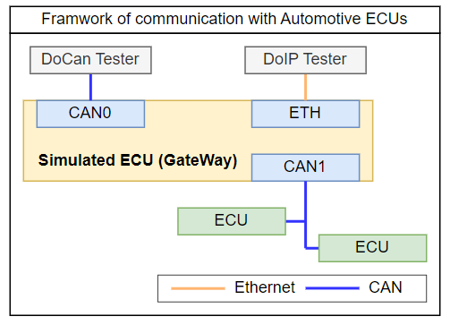

# Communication-simulator-for-automotive-ECU-based-on-STM32
### Project Design Description

#### Framework Overview
The project framework involves a Gateway Simulator acting as the central node, interfacing with both the DoCan Tester and the DoIP Tester via CAN and Ethernet connections, respectively. The ECU nodes are connected through the CAN interfaces, emphasizing the Gateway Simulator's role in routing and managing communications within the automotive body network. Given the complexity and scale of communication between actual vehicle nodes, this project will focus on the routing function of diagnostic communication. This means we will concentrate our efforts on developing and optimizing the data transmission paths related to vehicle diagnostics, ensuring efficient and reliable transfer of diagnostic information between different Electronic Control Units (ECUs). Through this approach, we aim to simplify the complex communication network and enhance the efficiency and accuracy of the diagnostic process. Please refer to the simple pic of architecture for better understanding.



#### Hardware: STM32H750VBT6

**Support CANFD**

The STM32H750VBt6 microcontroller is chosen for its high performance, multiple communication interfaces, and support for complex applications such as automotive body network nodes. This chip offers the following capabilities:
- **High Performance**: Suitable for demanding applications requiring fast processing speeds.
- **Multiple Communication Interfaces**: Supports various communication protocols essential for automotive applications, including CAN and Ethernet.
- **Complex Application Support**: Capable of handling sophisticated tasks like those found in automotive body networks.

#### Software: RT-Thread

RT-Thread is selected as the operating system for its robustness and compatibility with the STM32H750VBt6 microcontroller. It provides a stable platform for developing real-time applications, ensuring efficient management of system resources and facilitating the implementation of the required functionalities, such as CAN and Ethernet communication.

`The reason choose rt-thread`
1. I strongly agree with the concept of the RTThread project. The abstract and modular features will bring about a very good software architecture.

2. Since graduated, I have been working in automotive electronics and have not had any exposure to rtos other than AutosarOS. This is also a great opportunity to broaden my horizons

3. RTThread is a very friendly project. The community is very active and friendly. I can get help from the community very quickly.

#### Details of implemented functions
Please refer to the docs folder.

### Windows 构建与烧录

完整步骤、手工命令和故障排查见
[WINDOWS_BUILD_FLASH.md](H750VBT6_Simulated_AutoNode/Docs/WINDOWS_BUILD_FLASH.md)。
App 与 Boot 当前基于 RT-Thread 5.4.0 主线提交 `6fdfe700`，升级记录见
[RTTHREAD_UPGRADE.md](H750VBT6_Simulated_AutoNode/Docs/RTTHREAD_UPGRADE.md)。
硬件对齐和 DoIP 网关说明见
[HARDWARE_FROM_SCHEMATIC.md](H750VBT6_Simulated_AutoNode/Docs/HARDWARE_FROM_SCHEMATIC.md)
与 [DOIP.md](H750VBT6_Simulated_AutoNode/Docs/DOIP.md)。

Windows 工具链统一放在 `E:\tools`：

- `cmake-4.4.4-windows-x86_64`
- `xpack-arm-none-eabi-gcc-10.3.1-2.1`
- `mingw64`（GNU Make）
- `OpenOCD-20260302-0.12.0`

构建 Boot 和 QSPI App：

```powershell
cd H750VBT6_Simulated_AutoNode
.\Scripts\build-windows.ps1
```

烧录并校验两个镜像：

```powershell
.\Scripts\flash-windows.ps1
```

只烧录其中一个镜像：

```powershell
.\Scripts\flash-windows.ps1 -BootOnly
.\Scripts\flash-windows.ps1 -AppOnly
```

构建使用 `CMake + Unix Makefiles`，产物为
`Boot/build/RTThread-Boot.bin` 和 `App/build/Simulated-GW-ECU.bin`。

