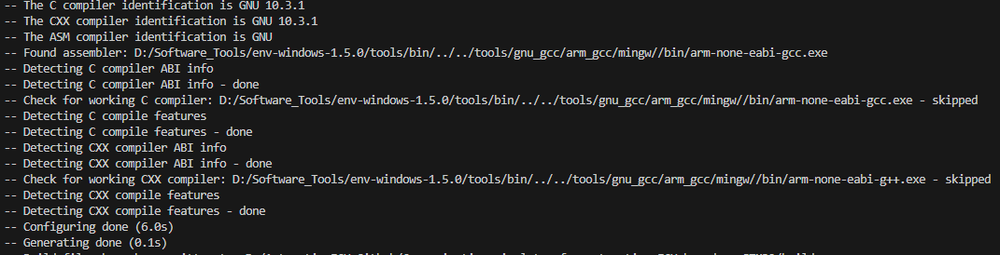
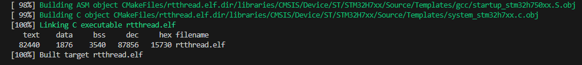
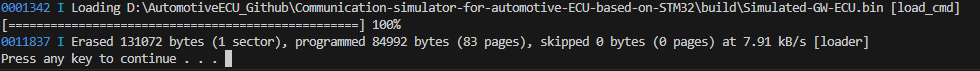
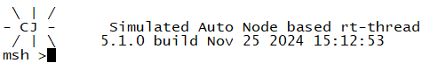
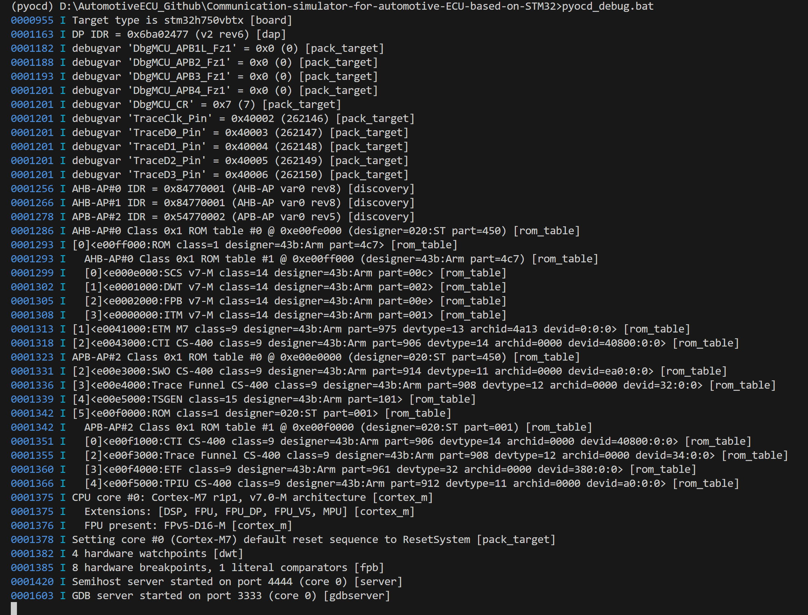
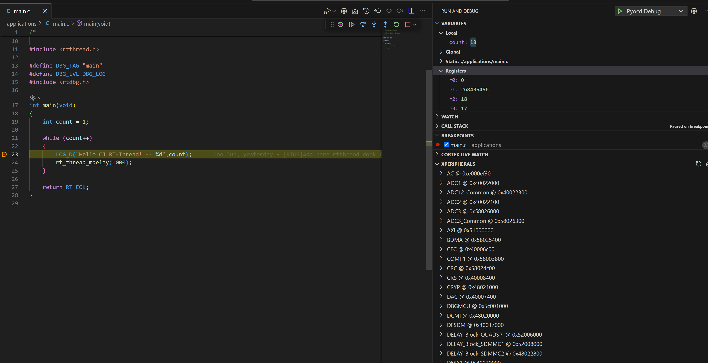

## Here is the guide to use this project 

`All descriptions are based on H750`

Due to limited resources, currently only able to maintain a development environment based on Windows. I believe it would be easy to migrate to Linux or MacOS environment.

### 1.Compile

#### 1.1 Set right tool path of `CMakeLists.txt`

```cmake
SET(TOOL_DIR "D:/Software_Tools/env-windows-1.5.0/tools/bin/../../tools/gnu_gcc/arm_gcc/mingw/")
```

#### 1.2 cmake generate

```shell
cd build
cmake .. -G "Unix Makefiles"
```

 

#### 1.3 compile project

```shell
make clean && make all -j28	
```

 

### 2.Flash

#### Flash by Pyocd

The `Scripts/pyocd_flash.bat` script is a batch file used to flash a binary file onto an STM32H750VBTx microcontroller using the `pyOCD` tool.

```bat
pyocd flash --target=STM32H750VBTx  --erase=auto --frequency=1000000 App/build/Simulated-GW-ECU.elf
```

- `pyocd flash`: This command uses the `pyOCD` tool to flash the specified binary file.
- `--target=STM32H750VBTx`: Specifies the target microcontroller model.
- `--erase=auto`: Automatically erases the flash memory before programming.
- `--frequency=1000000`: Sets the SWD (Serial Wire Debug) frequency to 1 MHz.
- `App/build/Simulated-GW-ECU.elf`: The path to the firmware that will be flashed onto the microcontroller

 

#### Result

 

### 3. Debug in VSCode

#### 3.1 Run bat or cmd like, which will activate a gdbserver task to monitor 

```bat
pyocd  gdbserver -t STM32H750VBTx 
```

 

#### 3.2 Config launch.json in VSCODE

```json
{
    "version": "0.2.0",
    "configurations": [
        {
            "name": "Pyocd Debug",
            "cwd": "${workspaceFolder}",
            "executable": "App/build/Simulated-GW-ECU.elf",
            "request": "launch",
            "type": "cortex-debug",
            "runToEntryPoint": "main",
            "targetId": "STM32H750VBTx",
            "showDevDebugOutput": "none",
            "svdFile": "Docs/STM32H750x.svd",
            "servertype": "pyocd",
            "serverpath": "pyocd",
            "armToolchainPath": "E:/tools/xpack-arm-none-eabi-gcc-10.3.1-2.1/bin",
            "gdbPath": "E:/tools/xpack-arm-none-eabi-gcc-10.3.1-2.1/bin/arm-none-eabi-gdb.exe",
        },
    ]
}
```

`serverpath`,`armToolchainPath`,`gdbPath`is the spcific path


